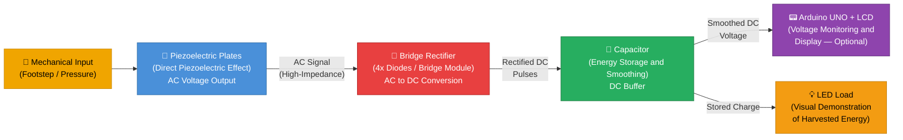
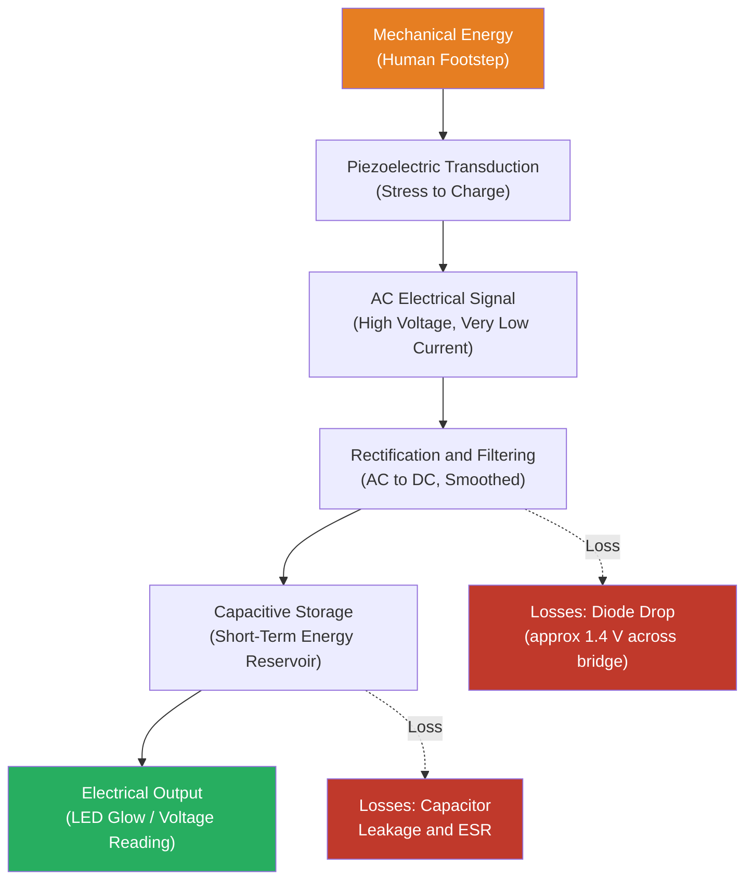

# ⚡ Energy Harvesting Using Piezoelectric Plates

<div align="center">


**A proof-of-concept prototype that harvests electrical energy from human footsteps using piezoelectric plates — converting everyday mechanical pressure into measurable DC voltage to power low-power loads such as LEDs.**

</div>

---

## 📑 Table of Contents

1. [Project Overview](#-project-overview)
2. [Problem Statement](#-problem-statement)
3. [Objectives](#-objectives)
4. [Key Features](#-key-features)
5. [Project Demonstration](#-project-demonstration)
6. [Hardware Components](#-hardware-components)
7. [Working Principle](#-working-principle)
8. [System Architecture](#-system-architecture)
9. [Circuit Diagram & Connections](#-circuit-diagram--connections)
10. [Software & Tools](#-software--tools)
11. [Implementation Steps](#-implementation-steps)
12. [Experimental Methodology](#-experimental-methodology)
13. [Calculations & Results](#-calculations--results)
14. [Applications](#-applications)
15. [Advantages & Limitations](#-advantages--limitations)
16. [Challenges & Solutions](#-challenges--solutions)
17. [Future Enhancements](#-future-enhancements)
18. [Project Structure](#-project-structure)
19. [Team Contributions](#-team-contributions)
20. [Learning Outcomes](#-learning-outcomes)
21. [Resume Description](#-resume-description)
22. [License & Acknowledgements](#-license--acknowledgements)

---

## 🔭 Project Overview

This project is a **proof-of-concept piezoelectric energy harvesting system** built as a prototype floor tile. When a person steps on the tile, the mechanical stress applied to embedded piezoelectric plates induces an alternating electric charge through the **direct piezoelectric effect**. This AC output is then rectified to DC, stored in a capacitor, and used to drive low-power loads such as LEDs — visually demonstrating that energy can be extracted from ordinary human footsteps.

Piezoelectric materials such as **Lead Zirconate Titanate (PZT)** generate a voltage when subjected to mechanical deformation. The effect is bi-directional: mechanical input produces electrical output (direct effect), and an applied voltage produces mechanical deformation (converse effect). This project exclusively exploits the **direct piezoelectric effect** for energy harvesting.

The prototype is intentionally scoped as an **educational and engineering demonstration**, appropriate for a second-year B.Tech project. It is not a commercial energy system; generated power is in the microwatt-to-milliwatt range and is sufficient only for very low-power loads.

---

## ❗ Problem Statement

A significant amount of mechanical energy is dissipated and lost every day in the form of human footsteps, structural vibrations, and ambient pressure changes. In high-footfall environments — such as college corridors, shopping malls, railway stations, and public walkways — this energy is entirely wasted.

Conventional energy generation methods rely on fossil fuels or large-scale renewable installations, both of which have environmental or infrastructure costs. **Energy harvesting from ambient mechanical sources** presents an opportunity to recover some of this otherwise wasted energy and use it for low-power applications, sensor nodes, or indicator systems without any primary power source.

Piezoelectric transducers offer a solid-state, passive, and low-maintenance mechanism for converting this mechanical energy into electricity. This project investigates the feasibility and practical challenges of such a system at the prototype scale.

---

## 🎯 Objectives

- **Demonstrate the direct piezoelectric effect** by generating a measurable voltage from applied mechanical pressure (footsteps).
- **Rectify the AC output** from piezoelectric plates into usable DC voltage using a bridge rectifier circuit.
- **Store generated energy** in a capacitor to smooth the output and supply a steady signal to a load.
- **Power a visible low-power load** (LEDs) to provide an observable demonstration of the harvested energy.
- **Measure and record** open-circuit voltage, loaded voltage, and qualitative output behaviour under varying mechanical inputs.
- **Evaluate the prototype** as a proof-of-concept for footstep-based energy harvesting in educational and research contexts.

---

## ✅ Key Features

> Only features actually implemented in this prototype are listed below.

- 🦶 **Footstep-driven energy generation** — Piezoelectric plates embedded in a floor tile generate AC voltage when compressed under foot pressure.
- 🔄 **AC-to-DC rectification** — A full-wave bridge rectifier converts the alternating piezoelectric output into direct current.
- 🔋 **Capacitive energy storage** — A capacitor smooths and temporarily stores the rectified DC energy between steps.
- 💡 **LED load demonstration** — The stored energy is discharged through LEDs, providing a real-time visual confirmation of energy harvest.
- 📐 **Multi-plate arrangement** — Multiple piezoelectric plates are connected to increase the total output voltage and current.
- 🖥️ **Voltage monitoring** — Output voltage is observed and recorded using a multimeter and/or Arduino-based analog measurement with LCD display.

---

## 📸 Project Demonstration

### Block Diagram

<div align="center">
  
  <br><em>Figure 1 — System block diagram showing energy flow from mechanical input to electrical load</em>
</div>

---

### Circuit Schematic

<div align="center">
  
  <br><em>Figure 2 — Circuit diagram including bridge rectifier, capacitor filter, and Arduino-based voltage measurement</em>
</div>

---

### Prototype Photographs

<table align="center">
  <tr>
    <td align="center" style="padding: 12px;">
      <strong>Breadboard Prototype</strong><br>
      
      <br><em>Fig 3 — Breadboard assembly with Arduino UNO and LCD</em>
    </td>
    <td align="center" style="padding: 12px;">
      <strong>Mounted Enclosure</strong><br>
      
      <br><em>Fig 4 — Circuit mounted on a wooden platform base</em>
    </td>
  </tr>
</table>

<div align="center" style="margin-top: 16px;">
  <strong>Complete Tile Assembly — Multiple Piezoelectric Plates</strong><br>
  
  <br><em>Figure 5 — Full floor tile showing the arrangement of multiple piezoelectric plates on the wooden substrate</em>
</div>

---

### Demonstration Video

> 📹 **`[Add demonstration video link here — e.g., Google Drive / YouTube]`**

---

## 🔩 Hardware Components

| # | Component | Purpose | Qty | Specifications / Notes |
|---|-----------|---------|-----|------------------------|
| 1 | **Piezoelectric Disc / Plate** | Primary transducer — converts mechanical stress to AC voltage | `[Qty]` | Ceramic piezo discs, typically 27 mm or 35 mm diameter; model `[specify]` |
| 2 | **Full-Wave Bridge Rectifier** | Converts AC output from piezo plates to DC | 1 | 4× 1N4007 diodes or pre-packaged bridge module (e.g., W10M) |
| 3 | **Electrolytic Capacitor** | Smooths and stores rectified DC output | `[Qty]` | `[Value in µF]`, `[Voltage rating]` — e.g., 1000 µF / 25 V |
| 4 | **Arduino UNO** | Analog voltage monitoring via ADC; optional display driver | 1 | ATmega328P, 10-bit ADC, 5 V operating voltage |
| 5 | **16×2 LCD Display** | Displays measured voltage in real time | 1 | HD44780 controller, 5 V supply |
| 6 | **LED(s)** | Low-power load to visually demonstrate harvested energy | `[Qty]` | Standard 5 mm LEDs; forward voltage ≈ 2.0–2.2 V |
| 7 | **Resistor(s)** | Current limiting for LEDs; voltage divider for ADC input | `[Qty]` | `[Values in Ω/kΩ as used]` |
| 8 | **Voltage Regulator / Booster** | Boosts low rectified voltage to a usable level (if used) | `[Qty]` | `[Module type and output voltage, if applicable]` |
| 9 | **Wooden Floor Tile / Platform** | Mechanical base for mounting piezo plates and circuit | 1 | `[Dimensions in cm]` |
| 10 | **Breadboard & Jumper Wires** | Prototyping and electrical connections | — | Standard half-size breadboard + male-to-male jumper wires |
| 11 | **Multimeter** | Measurement of open-circuit voltage, current, resistance | 1 | `[Model, e.g., Digital Multimeter DT9205A]` |
| 12 | **Power Supply (for Arduino)** | Powers the Arduino UNO separately from the harvested supply | 1 | USB 5 V supply or 9 V battery with barrel jack |

> **Note:** Quantities and specifications marked `[...]` should be updated to match the actual components used. Do not infer values that were not measured or recorded.

---

## ⚙️ Working Principle

### The Direct Piezoelectric Effect

Piezoelectric materials contain crystalline structures (e.g., PZT — Lead Zirconate Titanate) in which positive and negative charge centres do not coincide when the material is mechanically deformed. When **external mechanical stress** is applied — such as a footstep compressing a plate — the internal dipoles align, producing a net **surface charge** and a corresponding **voltage difference** across the electrodes.

This relationship is expressed as:

$$D = d \cdot T + \varepsilon^T \cdot E$$

Where:
- $D$ = electric displacement (C/m²)
- $d$ = piezoelectric charge coefficient (C/N)
- $T$ = applied mechanical stress (Pa)
- $\varepsilon^T$ = permittivity at constant stress
- $E$ = applied electric field (V/m)

For energy harvesting, we operate in the open-circuit voltage mode and the short-circuit charge mode, then condition the output for a practical load.

### Voltage vs. Usable Power — A Critical Distinction

Piezoelectric plates can produce surprisingly high **open-circuit voltages** (sometimes tens of volts) under a single footstep, but this does **not** imply high power or energy. Because the internal impedance of piezo elements is very high (capacitive), the available **short-circuit current is extremely small** (typically in the microampere range). As a result:

- **Open-circuit voltage (V_oc):** The voltage measured with no current flowing — gives an impression of large output but cannot drive any load directly.
- **Loaded voltage (V_L):** The voltage when a load is connected — drops significantly compared to V_oc due to the high source impedance.
- **Usable electrical power (P):** The actual power delivered to the load, calculated as P = V_L × I_L, which is typically in the microwatt to low-milliwatt range per step.

This prototype demonstrates the concept but does not generate power sufficient to charge batteries or drive anything beyond very small LED loads under repeated footsteps.

### Signal Conditioning Chain

```
Piezo Plates (AC, high-impedance) → Bridge Rectifier → Capacitor Filter → Load (LED / Measurement)
```

The **bridge rectifier** performs full-wave rectification so that both the positive and negative half-cycles of the piezo output are converted to positive DC pulses. The **capacitor** then acts as a reservoir, partially smoothing the pulsed DC between footsteps, and storing enough charge to sustain a brief LED glow.

---

## 🏗️ System Architecture



### Energy Flow with Losses



---

## 🔌 Circuit Diagram & Connections

### Circuit Description

The circuit follows a standard **piezoelectric energy harvesting topology**:

1. **Piezoelectric Plates** are connected in parallel (to increase current capacity) or in series (to increase voltage), depending on the design choice and the measured characteristics of the individual plates.
2. The combined output feeds into a **full-wave bridge rectifier** consisting of four 1N4007 diodes (or equivalent bridge module). The bridge rectifier has two AC input terminals and two DC output terminals (positive rail and negative/GND rail).
3. The rectified DC output is connected across an **electrolytic capacitor** for smoothing and storage. The capacitor's positive terminal connects to the positive DC rail, and the negative terminal to GND.
4. The **LED load** (with a current-limiting resistor in series) is connected in parallel with the capacitor — across the positive rail and GND — to draw the stored energy.
5. A **voltage divider** (two resistors) scales the output voltage down to within the 0–5 V range of the **Arduino UNO's analog input (A0)**, allowing the ADC to monitor and display the voltage on the LCD.

> ⚠️ **Important:** Actual pin assignments, resistor values, and series/parallel plate configuration should be verified against the physical circuit and the circuit schematic in `images/Circuit-Diagram.jpeg`. The description above is general; do not treat it as a definitive wiring reference without cross-checking.

### General Connection Reference Table

| From | To | Signal Type | Notes |
|------|----|-------------|-------|
| Piezo Plate (+) terminal | Bridge Rectifier AC input 1 | AC | Plate polarity may vary; check experimentally |
| Piezo Plate (−) terminal | Bridge Rectifier AC input 2 | AC | |
| Bridge Rectifier DC (+) | Capacitor (+), LED anode (via resistor) | Rectified DC | |
| Bridge Rectifier DC (−) | Capacitor (−), Arduino GND, Circuit GND | GND | Common ground |
| Capacitor (+) | Arduino A0 (via voltage divider) | Analog DC | Divide down to 0–5 V range |
| Arduino 5V / GND | LCD VCC / GND | Power | Separate 5 V supply for Arduino |
| Arduino pins | LCD RS, EN, D4–D7 | Digital | Standard 4-bit LCD wiring |

> 📌 Refer to `images/Circuit-Diagram.jpeg` for the complete, verified schematic.

---

## 🖥️ Software & Tools

This is primarily a **hardware-based project**. The software component is limited to a simple Arduino sketch for voltage monitoring and display.

| Tool / Instrument | Purpose | Notes |
|-------------------|---------|-------|
| **Arduino IDE** | Writing and uploading the voltage monitoring sketch to Arduino UNO | Version `[specify]` |
| **Arduino UNO (ATmega328P)** | Reads analog voltage via ADC; drives LCD display | 10-bit ADC, 0–5 V input range |
| **Digital Multimeter** | Direct measurement of open-circuit voltage, loaded voltage, and current | Model `[specify]` |
| **Oscilloscope** *(if available)* | Observing raw AC waveform from piezo plates before rectification | `[Specify if used]` |
| **Tinkercad / Proteus** *(if used)* | Circuit simulation and schematic design | `[Specify if used]` |
| **MS Excel / Google Sheets** | Tabulating and analysing experimental readings | `[Specify if used]` |

> If no simulation or software tools were used beyond the Arduino sketch, state that clearly and remove inapplicable rows.

---

## 🛠️ Implementation Steps

### Step 1 — Piezoelectric Plate Preparation
- Obtain ceramic piezoelectric discs/plates of the chosen size (e.g., 27 mm or 35 mm diameter).
- Solder thin wires to the top (signal) and bottom (ground) electrodes of each plate. Handle with care — piezo ceramics are brittle and crack easily.
- Test each plate individually with a multimeter in AC voltage mode by pressing and releasing: a measurable AC pulse confirms the plate is functional.

### Step 2 — Plate Arrangement on Tile
- Mark the positions of each plate on the wooden tile base.
- Secure plates firmly using adhesive, ensuring even contact with the tile surface so that foot pressure is distributed across all plates.
- Connect multiple plates in **parallel** (to sum currents) or **series** (to sum voltages) based on the desired output and the measured individual plate characteristics.

### Step 3 — Bridge Rectifier Assembly
- Assemble four 1N4007 diodes in the full-wave bridge configuration on a breadboard.
- Connect the two AC input nodes to the combined output of the piezo plates.
- Verify DC output polarity at the positive and negative rails using a multimeter before connecting the capacitor.

### Step 4 — Capacitor and Load Connection
- Connect the electrolytic capacitor across the DC rails (observe correct polarity — positive terminal to positive rail).
- Connect the LED load (with a series current-limiting resistor) in parallel with the capacitor.
- Verify the complete circuit for continuity and correct polarity before testing.

### Step 5 — Voltage Monitoring (Arduino)
- Build the voltage divider network to scale the harvested voltage into the 0–5 V range of the Arduino ADC.
- Upload the Arduino sketch to read the analog value, convert it to voltage, and display it on the LCD.
- Verify the displayed value against a multimeter reading to confirm accuracy.

### Step 6 — Mechanical Input & Output Observation
- Apply foot pressure to the tile in a controlled manner (single steps, repeated steps, varying weight/speed).
- Observe: LED glow, voltage reading on multimeter/LCD, and qualitative behaviour of the output.
- Record all observations systematically for the results section.

---

## 🧪 Experimental Methodology

The following measurements characterise the performance of the harvesting system:

### 1. Open-Circuit Voltage (V_oc)
- Disconnect the load (LEDs) and the rectifier from the piezo plates.
- Set the multimeter to AC Volts mode.
- Apply a single footstep or a controlled press and record the peak and average AC voltage from the plates.
- This represents the maximum voltage the plates can produce but is **not indicative of usable power**.

### 2. Rectified DC Voltage (V_dc, no load)
- Reconnect the bridge rectifier and capacitor but keep the LED load disconnected.
- Set the multimeter to DC Volts mode across the capacitor.
- Apply repeated footsteps and record the DC voltage that builds up on the capacitor.

### 3. Loaded Voltage (V_L) and Current (I_L)
- Connect the LED load.
- Measure the voltage across the LED circuit and the current through it using the multimeter (in series for current measurement).
- Compare V_L with V_dc (no load) to observe the voltage drop under load — expected to be significant due to high piezo source impedance.

### 4. Power and Energy Estimation
- Calculate electrical power delivered to the load: **P = V_L × I_L**
- Estimate energy stored in the capacitor: **E = ½ × C × V²**
- If possible, time the LED glow duration after a set number of steps to estimate energy delivery rate.

### 5. Repeatability
- Repeat measurements under identical conditions (same person, same step pressure) to assess consistency of output.
- Record variations to understand the intermittent and stochastic nature of footstep energy.

---

## 📊 Calculations & Results

### Governing Formulas

| Formula | Description |
|---------|-------------|
| $P = V \times I$ | Electrical power delivered to the load (Watts) |
| $E = P \times t$ | Energy delivered over time $t$ (Joules), when power is approximately constant |
| $E = \frac{1}{2} C V^2$ | Energy stored in a capacitor of capacitance $C$ charged to voltage $V$ (Joules) |
| $V_{out} = V_{in} \times \frac{R_2}{R_1 + R_2}$ | Voltage divider for ADC input scaling |

> **Note on Power:** Because piezoelectric output is intermittent (only during deformation and release) and the source impedance is very high, the average power over time is much lower than the instantaneous peak power. Reported values should specify whether they are peak, average, or time-integrated.

### Results Table

> 📌 **All values below are placeholders. Replace with actual experimental readings.**
> Do **not** fabricate or estimate values; leave cells blank or as `—` if measurements were not taken.

| Test Condition | Open-Circuit AC Voltage (V_oc) | Rectified DC Voltage (no load) | Loaded DC Voltage (V_L) | Load Current (I_L) | Estimated Power (P = V_L × I_L) | Observations |
|---------------|-------------------------------|-------------------------------|------------------------|-------------------|--------------------------------|--------------|
| Single light step | `___ V` | `___ V` | `___ V` | `___ µA / mA` | `___ µW / mW` | `[LED glow? Dim/Bright/None]` |
| Single firm step | `___ V` | `___ V` | `___ V` | `___ µA / mA` | `___ µW / mW` | `[Observations]` |
| 5 repeated steps | `___ V` | `___ V` | `___ V` | `___ µA / mA` | `___ µW / mW` | `[Capacitor charging observed?]` |
| 10 repeated steps | `___ V` | `___ V` | `___ V` | `___ µA / mA` | `___ µW / mW` | `[Observations]` |
| Jump / heavy pressure | `___ V` | `___ V` | `___ V` | `___ µA / mA` | `___ µW / mW` | `[Observations]` |

### Capacitor Energy Storage (Example Calculation Format)

If the capacitor charges to a voltage $V_C$ (to be filled from actual readings):

$$E_{stored} = \frac{1}{2} \times C \times V_C^2$$

*Example format (do not treat as experimental result):* If C = 1000 µF and V_C = 5 V → E = ½ × 1000×10⁻⁶ × 25 = **12.5 mJ**

This is the theoretical maximum energy extractable; actual usable energy will be lower due to diode drops, capacitor ESR, and load impedance mismatch.

---

## 🌍 Applications

The following applications are **potential use cases** for piezoelectric energy harvesting. Feasibility depends on the power levels achievable, which for this prototype are in the µW–mW range:

| Application | Description | Feasibility at Prototype Scale |
|------------|-------------|-------------------------------|
| **Footstep energy harvesting** | Embedding piezo tiles in corridors, railway stations, or malls to harvest footfall energy | Conceptual — low per-step energy; feasible only at scale with many tiles |
| **Structural health monitoring** | Using piezo sensors embedded in bridges or buildings to harvest vibration energy and power embedded sensors | Low-power sensors possible; requires impedance matching |
| **Self-powered IoT sensors** | Powering wireless sensor nodes from ambient vibration without a battery | Possible for ultra-low-power nodes (e.g., BLE beacons with duty cycling) |
| **Educational demonstration** | Teaching energy harvesting, transducer physics, and circuit design in labs | Directly applicable — this is the primary scope of this prototype |
| **Emergency lighting indicators** | Powering LED indicators in areas with high foot traffic as auxiliary signals | Demonstrative; not a replacement for primary lighting |

> ⚠️ **Disclaimer:** This prototype does **not** generate sufficient power to charge smartphones, run household appliances, or supply continuous power to electronics. Any such claims require verified experimental evidence at much larger scale.

---

## ⚖️ Advantages & Limitations

### ✅ Advantages

- **Passive energy recovery** — Harvests energy from an otherwise wasted mechanical source, with no fuel or primary energy input.
- **Solid-state and low-maintenance** — No moving parts in the transducer itself; piezo elements are mechanically simple.
- **Scalable concept** — More plates, optimised plate geometry, and better power conditioning can incrementally improve output.
- **Environmentally benign during operation** — No emissions during energy harvesting.
- **Educational value** — Provides tangible, hands-on learning about transducers, rectifiers, energy storage, and circuit design.
- **Dual-use potential** — The same piezo elements can function as both sensors (measuring force) and generators (harvesting energy).

### ❌ Limitations

- **Very low power output** — The energy per footstep is extremely small (µJ to low mJ); not suitable for continuous or high-power loads.
- **Intermittent and stochastic output** — Voltage is generated only during the compression and release transient; there is no output between footsteps.
- **High source impedance** — The capacitive nature of piezo elements means that voltage collapses significantly under load, resulting in poor power transfer unless impedance matching is implemented.
- **Diode drop losses** — A full-wave bridge rectifier introduces a forward voltage drop of approximately 1.2–1.4 V (two diodes in series at any given time), which is significant when the raw piezo output is small.
- **Plate fragility** — Ceramic piezo elements are brittle and can crack under excessive or uneven mechanical loads.
- **Practical power gap** — The gap between generated power and the power requirements of most real-world devices remains large without power management circuits, supercapacitors, and energy accumulation over time.

---

## 🚧 Challenges & Solutions

| Challenge Encountered | Root Cause | Solution / Mitigation Applied |
|----------------------|------------|-------------------------------|
| **Unstable / flickering LED output** | Intermittent piezo voltage; no sustained current between footsteps | Added capacitor as energy buffer; LED flickers briefly per step — expected behaviour |
| **Very low loaded voltage** | High source impedance of piezo plates causes voltage collapse under load | Increased capacitor size; reduced load to minimum (single LED with high-value series resistor) |
| **V_oc appears high but V_L is very low** | Piezo source impedance mismatch with low-impedance load | Documented as a fundamental property of piezoelectric sources; explained in results |
| **Plate output varies with position** | Uneven pressure distribution across tile geometry or plate mounting | Distributed plates evenly; tested under full foot contact vs. heel/toe contact |
| **Rectified voltage below diode threshold** | Very small piezo output; two diode drops (~1.4 V total) consume much of the signal | Identified use of Schottky diodes (lower V_f ~0.3 V) as a potential improvement |
| **Plates cracking during testing** | Fragile ceramic substrate; excessive or off-centre mechanical load | Mounted plates on padded substrate; distributed load using a rigid plate above the piezo array |
| **Inconsistent readings between test runs** | Variable step pressure and plate contact area | Standardised test procedure; recorded range of values rather than a single-point reading |

---

## 🚀 Future Enhancements

> The following are **proposed extensions**, not features currently implemented in this prototype.

- 🔧 **Schottky diode rectifier** — Replace 1N4007 diodes with Schottky diodes (e.g., 1N5819) to reduce forward voltage drop from ~0.7 V to ~0.3 V per diode, improving efficiency at low input voltages.
- ⚡ **MPPT / impedance matching circuit** — Implement a Maximum Power Point Tracking (MPPT) circuit to dynamically match the source impedance of the piezo elements to the load for maximum power transfer.
- 🔋 **Supercapacitor storage** — Replace or supplement the electrolytic capacitor with a supercapacitor (e.g., 1 F, 5.5 V) to store more energy and sustain the load for longer after each step.
- 📈 **Power management IC** — Integrate a dedicated energy harvesting IC (e.g., LTC3588, BQ25504) that handles MPPT, voltage regulation, and efficient charging of a storage element.
- 📡 **IoT monitoring** — Add a low-power wireless node (e.g., ESP32 in deep sleep, BLE sensor) powered partly by the harvested energy to log footfall count and estimated energy generated in real time.
- 🏗️ **Multi-tile scale-up** — Connect multiple tiles in a corridor to aggregate harvested energy and evaluate cumulative output under realistic foot traffic conditions.
- 📊 **Data logging** — Record voltage and current waveforms over time using an oscilloscope or a data acquisition module to build a complete energy profile per step.
- 🔬 **Alternative piezo materials** — Investigate PVDF (polyvinylidene fluoride) films as a more flexible and mechanically robust alternative to rigid ceramic PZT discs.

---

## 📁 Project Structure

```
Energy-Harvesting-with-Piezoelectric-Plates/
│
├── images/
│   ├── Block-Diagram.jpeg          # System block diagram
│   ├── Circuit-Diagram.jpeg        # Full circuit schematic
│   ├── image1.jpeg                 # Breadboard prototype with Arduino UNO and LCD
│   ├── image2.jpeg                 # Circuit mounted on wooden base
│   └── image3.jpeg                 # Complete floor tile with multiple piezo plates
│
├── src/                            # [Suggested] Arduino sketches and code
│   └── voltage_monitor.ino         # [Add] Arduino sketch for ADC-based voltage display
│
├── docs/                           # [Suggested] Project documentation
│   ├── project_report.pdf          # [Add] Full project report
│   ├── component_datasheet.pdf     # [Add] Piezo plate / component datasheets
│   └── experimental_data.xlsx      # [Add] Recorded measurements and analysis
│
├── LICENSE                         # MIT License
└── README.md                       # This file
```

> 📌 Paths marked `[Add]` or `[Suggested]` are recommended additions; adapt the structure to match your actual repository contents.

---

## 👥 Team Contributions

| Team Member | Role | Contributions |
|-------------|------|---------------|
| **Vansh Thakur** | `[Role — e.g., Team Lead / Hardware Design]` | `[e.g., Circuit design, component sourcing, Arduino programming, documentation]` |
| **`[Team Member 2 Name]`** | `[Role]` | `[Contributions]` |
| **`[Team Member 3 Name]`** | `[Role]` | `[Contributions]` |

> Update the above table with the actual names, roles, and contributions of all team members.

**Institution:** Chitkara University, Punjab
**Programme:** B.Tech — `[Branch, e.g., Computer Science Engineering / Electronics Engineering]`
**Academic Year:** `[e.g., 2024–25, Semester III/IV]`
**Guide / Supervisor:** `[Faculty name and department]`

---

## 🎓 Learning Outcomes

Through the design, assembly, and testing of this project, the team developed practical understanding and skills in:

- ⚡ **Piezoelectricity** — The direct and converse piezoelectric effects, material properties, and the physical origin of voltage generation under mechanical stress.
- 🔄 **Energy conversion** — The multi-stage conversion chain from mechanical energy to electrical energy, including conversion losses at each stage.
- 🔌 **Rectifier circuit design** — Full-wave bridge rectifier operation, diode characteristics, and the significance of forward voltage drop in low-power circuits.
- 🔋 **Energy storage** — Capacitor charging and discharging behaviour, the relationship between capacitance, voltage, and stored energy.
- 📏 **Electrical measurements** — Using multimeters to measure AC and DC voltage, current, and resistance; understanding the distinction between open-circuit and loaded measurements.
- 📐 **Impedance concepts** — Understanding source impedance, load impedance, and the impact of impedance mismatch on power delivery.
- 🛠️ **Hardware prototyping** — Breadboard assembly, soldering, mechanical integration of electronics with physical structures, and systematic debugging.
- 📊 **Experimental analysis** — Designing a measurement methodology, recording data systematically, and interpreting results in the context of theoretical expectations.
- 📝 **Technical documentation** — Writing clear engineering documentation, structuring a project report, and presenting technical work for academic assessment.

---

## 📄 Resume Description

> The following bullet points are written for use in a B.Tech engineering student's resume under a **Projects** section. They are framed around skills and actions demonstrated, without fabricating specific performance metrics.

- **Designed and assembled** a piezoelectric energy harvesting prototype floor tile that converts mechanical footstep pressure into measurable DC electrical energy using ceramic piezo transducers, a full-wave bridge rectifier, and capacitive storage — demonstrating the feasibility of ambient mechanical energy recovery at the prototype scale.
- **Integrated Arduino UNO** for real-time analog voltage monitoring and LCD display, implementing ADC-based measurement with voltage divider scaling to characterise the rectified DC output under varying mechanical input conditions.
- **Analysed the energy conversion chain** from mechanical input through transduction, rectification, and capacitive storage to a low-power LED load — gaining practical understanding of source impedance effects, diode conduction losses, and the distinction between open-circuit voltage and usable electrical power.

---

## 📜 License & Acknowledgements

### License

This project is licensed under the **MIT License** — see the [LICENSE](LICENSE) file for details.

```
MIT License
Copyright (c) 2025 Vansh Thakur
```

### Acknowledgements

- **Chitkara University, Punjab** — for providing laboratory facilities and institutional support.
- **`[Supervisor / Faculty Name]`** — for guidance and technical oversight throughout the project.
- **`[Any referenced textbook or paper]`** — e.g., *Piezoelectric Energy Harvesting* by Erturk & Inman; IEEE papers on ambient energy harvesting.
- The open-source Arduino community for libraries and reference implementations used in this project.

---

<div align="center">

**⭐ If you found this project useful or educational, please consider starring the repository.**

Made with 🔩 and ⚡ by **Vansh Thakur** | Chitkara University, Punjab

[](https://github.com/Vans30m)

</div>
