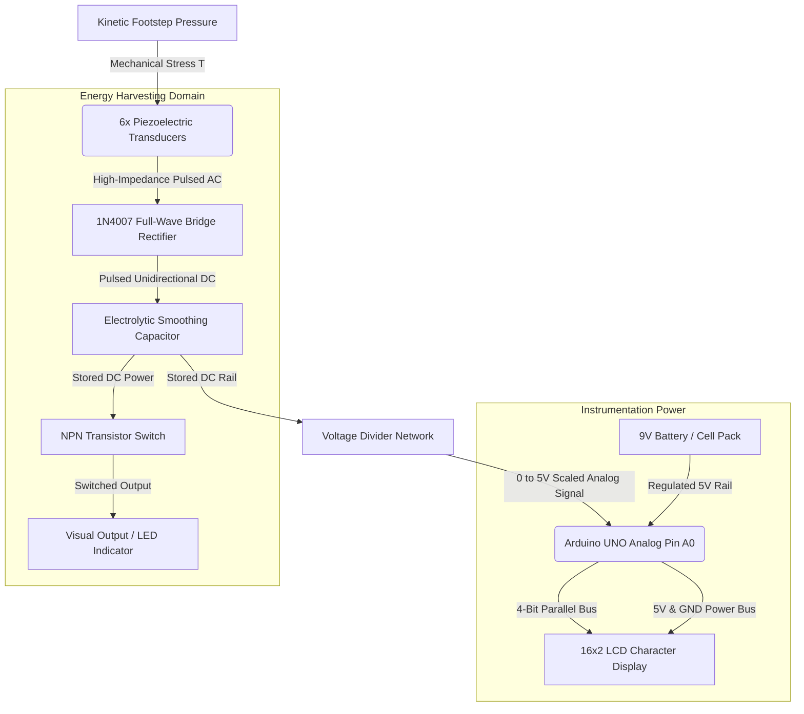
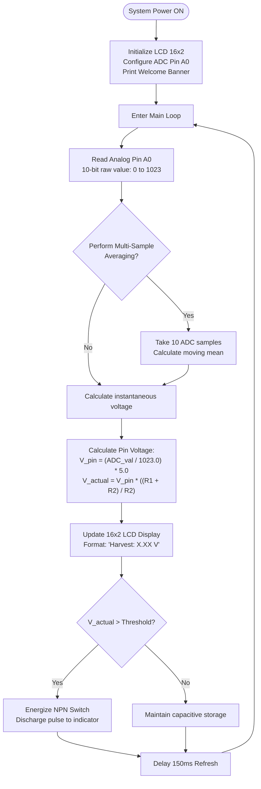

# Energy-Harvesting-with-Piezoelectric-Plates

<div align="center">

# Energy Harvesting with Piezoelectric Plates

[](https://opensource.org/licenses/MIT)
[](https://www.arduino.cc/)
[](https://isocpp.org/)
[]()
[](https://sdgs.un.org/goals/goal7)
[](https://sdgs.un.org/goals/goal11)

**A footstep-driven micro-energy harvesting prototype** that converts kinetic footfall pressure into conditioned DC electrical power using an array of ceramic piezoelectric discs, full-wave diode bridge rectification, electrolytic capacitive storage, and real-time LCD voltage instrumentation via Arduino UNO.

*B.Tech Computer Science Engineering — Chitkara University, Punjab*

---

</div>

## Table of Contents

- [Project Overview](#project-overview)
- [Key Features](#key-features)
- [Project Demo](#project-demo)
- [Hardware Components](#hardware-components)
- [Software & Technologies](#software--technologies)
- [System Architecture](#system-architecture)
- [Working Principle](#working-principle)
- [Circuit Connections](#circuit-connections)
- [Installation & Setup](#installation--setup)
- [Algorithm / Workflow](#algorithm--workflow)
- [Calculations & Governing Equations](#calculations--governing-equations)
- [Testing & Results](#testing--results)
- [Applications](#applications)
- [Advantages & Limitations](#advantages--limitations)
- [Future Enhancements](#future-enhancements)
- [Learning Outcomes](#learning-outcomes)
- [Project Structure](#project-structure)
- [Resume Description](#resume-description)
- [License & Acknowledgements](#license--acknowledgements)

---

## Project Overview

Mechanical kinetic energy is continuously dissipated and lost in everyday environments through pedestrian footsteps, vehicular vibrations, and ambient structural stress. In high-density footfall zones — including academic corridors, transit hubs, railway concourses, and shopping malls — gigajoules of potential kinetic energy go completely unharvested.

The **Energy Harvesting with Piezoelectric Plates** project investigates and demonstrates a sustainable energy recovery system at prototype scale. By embedding an array of Lead Zirconate Titanate (PZT) ceramic piezoelectric transducer discs into a floor tile assembly, mechanical strain induced by footsteps is directly transduced into electrical potential via the **direct piezoelectric effect**.

The prototype integrates an end-to-end signal conditioning and monitoring pipeline:

| Subsystem | Function | Implementation |
|-----------|----------|----------------|
| **Transducer Array** | Strain-to-charge mechanical conversion | 6× 35mm PZT ceramic piezoelectric discs arranged on a wooden floor tile |
| **AC-DC Rectification** | Converts bi-directional pulsed AC into single-polarity DC | Full-wave diode bridge rectifier circuit (1N4007 diodes) |
| **Filtration & Storage** | Buffers pulse energy, smooths ripple, holds charge | High-capacitance electrolytic reservoir capacitor |
| **Switching & Load** | Visual output demonstration and energy release | NPN transistor low-side switch driving a visual indicator |
| **Telemetry & Display** | Analog sampling and real-time voltage readout | Arduino UNO ATmega328P ADC with 16×2 HD44780 LCD display |

---

## Key Features

- **Direct Kinetic-to-Electrical Transduction** — Converts human footstep compressions directly into transient electrical impulses without gears, dynamos, or moving mechanical parts.
- **6-Element Piezo Array Configuration** — Multi-disc cluster engineered to capture force across a designated tile contact footprint.
- **Full-Wave Bridge Rectification** — Converts both compressive (+ charge) and elastomeric release (− charge) stress cycles into usable positive DC pulses.
- **Transient Capacitive Energy Buffer** — Electrolytic reservoir capacitor accumulates discontinuous energy bursts into a smoothed DC potential rail.
- **NPN Transistor Load Switching** — Transistor-buffered circuit allowing the micro-harvested potential to trigger and switch low-power indicator loads safely.
- **Real-Time Embedded Instrumentation** — Arduino UNO continuously samples the rectified voltage via a 10-bit Analog-to-Digital Converter (ADC) and outputs real-time voltage telemetry to an LCD display.
- **Zero Fuel / Solid-State Operation** — Fully passive energy generation with zero carbon emissions, silent operation, and high theoretical transducer lifespan.
- **Modular Tile Architecture** — Self-contained wooden platform substrate housing both the transducer array and the conditioning / instrumentation stack.

---

## Project Demo

### Hardware Prototype & Schematics

<p align="center">
  <b>System Block Diagram</b><br>
  
</p>

<p align="center">
  <b>Tinkercad Circuit Schematic & Breadboard Wiring</b><br>
  
</p>

<p align="center">
  <b>Breadboard Electronics & Instrumentation Unit</b><br>
  
</p>

<p align="center">
  <b>Platform Assembly with 6-Disc Transducer Array</b><br>
  
</p>

<p align="center">
  <b>Complete Working Prototype on Wooden Base</b><br>
  
</p>

---

## Hardware Components

| Component | Part / Model | Role |
|-----------|-------------|------|
| **Microcontroller** | Arduino UNO (ATmega328P) | Digitizes harvested voltage rail via 10-bit ADC, calculates scaling, drives LCD |
| **Piezoelectric Transducers** | 6× PZT Ceramic Discs (35mm brass backing) | Primary mechanical-to-electrical kinetic transducers |
| **Display Module** | 16×2 Character LCD (HD44780 compatible) | Real-time visual readout of harvested voltage level |
| **Diode Bridge Rectifier** | 4× 1N4007 Silicon Rectifier Diodes | Full-wave rectification of raw high-impedance AC piezo pulses |
| **Storage Element** | Electrolytic Capacitor (e.g., 1000µF / 25V) | Filters voltage ripple and stores accumulated impulse charge |
| **Switching Transistor** | NPN Transistor (e.g., BC547 / 2N2222) | Low-side load switch controlled by pulse or microcontroller |
| **Resistors** | 1kΩ, 10kΩ Carbon Film Resistors | Voltage divider scaling network and transistor base-current limiting |
| **Secondary Power Supply** | 9V DC Battery / 2-Slot 18650 Battery Holder | Dedicated rail to power Arduino UNO & LCD display independently |
| **Prototyping Board** | Half-Size Solderless Breadboard | Interconnect platform for diodes, capacitor, transistor, and telemetry wiring |
| **Substrate / Chassis** | Wooden Platform Base Tile | Structural mounting platform for mechanical foot pressure distribution |

---

## Software & Technologies

| Layer | Technology | Purpose |
|-------|-----------|---------|
| **Firmware Development** | Embedded C++ / Arduino IDE | ADC analog voltage sampling, signal averaging, LCD driver logic |
| **Display Library** | `LiquidCrystal.h` (Built-in) | Parallel 4-bit bus interface driver for 16×2 LCD screen |
| **Circuit Simulation** | Autodesk Tinkercad Circuits | Virtual schematic capture, component validation, and breadboard layout design |
| **Data Analysis** | Microsoft Excel / Sheets | Tabulation of experimental footstep voltages and energy calculations |
| **Development Environment** | Arduino IDE v1.8.x / v2.x | Firmware compilation, serial debugging, and microcontroller flashing |

---

## System Architecture

The overall architecture separates high-impedance micro-generation from the independent instrumentation and load domains:



**System Data & Energy Flow:**
1. A footstep exerts dynamic mechanical pressure onto the ceramic discs, exciting internal dipole displacement.
2. The generated AC output travels through the 1N4007 full-wave diode bridge, converting bidirectional spikes to positive pulses.
3. The pulses charge the reservoir electrolytic capacitor, establishing a smoothed DC bus.
4. A precision resistive divider scales the capacitor voltage into the safe 0–5V range accepted by Arduino ADC pin `A0`.
5. The ATmega328P digitizes the signal, applies calibration offsets, and updates the 16×2 LCD screen with the voltage reading.

---

## Working Principle

### 1. Direct Piezoelectric Effect
Piezoelectric materials, notably **Lead Zirconate Titanate ($Pb[Zr_xTi_{1-x}]O_3$ - PZT)**, exhibit non-centrosymmetric crystalline structures. In their undisturbed state, electrical dipole moments cancel each other out.

When an external mechanical force ($F$) produces compressive mechanical stress ($T$), lattice displacement shifts the positive and negative ion centers, generating an instantaneous net surface charge density ($D$):

$$D = d \cdot T + \varepsilon^T \cdot E$$

Where:
- $d$ is the piezoelectric charge coefficient (Coulombs per Newton, $C/N$).
- $T$ is the mechanical stress applied ($N/m^2$).
- $\varepsilon^T$ is the material permittivity under constant stress.
- $E$ is the electric field intensity.

### 2. High Voltage vs. Usable Power (Impedance Reality)
A single sharp step on an unloaded piezo disc can easily produce an **open-circuit voltage ($V_{oc}$)** exceeding $15\text{V} - 30\text{V}$. However, this does **not** signify abundant energy:
- **Internal Impedance:** Piezoelectric transducers exhibit predominantly capacitive source impedance ($C_p \approx 10\text{nF} - 30\text{nF}$), meaning internal series impedance at low mechanical frequencies is very high ($Z_s = \frac{1}{2\pi f C_p} \approx M\Omega$).
- **Available Current:** Because of this high source impedance, instantaneous short-circuit current is measured in microamperes ($\mu\text{A}$).
- **Energy Bottleneck:** Bridging the gap between high voltage/micro-current and practical electronics requires full-wave rectification and reservoir accumulation before driving low-impedance loads.

### 3. Step-by-Step Cycle
1. **Compression Phase:** The user steps on the tile. The sudden compressive force induces a sharp positive voltage spike across the disc electrodes.
2. **Rectification Phase:** Two diodes in the 1N4007 bridge conduct, steering current into the positive terminal of the electrolytic capacitor.
3. **Release Phase:** As the foot lifts, the plate mechanically rebounds, inducing a reverse-polarity voltage spike. The opposing diode pair conducts, continuing to charge the capacitor in the same DC orientation.
4. **Charge Accumulation:** Repeated footfall impacts inject successive charge packets into the capacitor, stepping up its stored voltage ($V_C$).
5. **Measurement & Indication:** The scaled DC voltage is read by the Arduino ADC, output to the LCD, and can be discharged through the NPN transistor stage to trigger output indicators.

---

## Circuit Connections

> **Critical:** The Arduino GND and the negative DC rail of the energy harvesting circuit **must be tied to a common ground** for accurate ADC voltage sampling.

### Master Pinout & Connection Table

| Component | Pin / Terminal | Connected To | Signal / Wire Type | Function |
|-----------|----------------|--------------|-------------------|----------|
| **Piezo Array** | Positive Bus (+) | Bridge AC Terminal 1 | AC Input | Raw positive charge pulses |
| | Negative Bus (−) | Bridge AC Terminal 2 | AC Input | Raw return charge pulses |
| **Bridge Rectifier** | AC 1 & AC 2 | Piezo Array (+ / −) | AC Input | Diode bridge input |
| | DC Output (+) | Capacitor (+), Divider $R_1$ | Rectified DC | Positive rectified energy bus |
| | DC Output (−) | Capacitor (−), Circuit GND | Ground | Harvesting negative rail |
| **Reservoir Capacitor** | Positive Lead (+) | Bridge DC (+), Divider $R_1$ | DC Bus | Charge storage & filtering |
| | Negative Lead (−) | Common Ground (GND) | Ground | Negative reference |
| **Voltage Divider** | Resistor $R_1$ (Top) | Capacitor (+) | High Voltage Sense | Drops voltage to < 5V safe window |
| | Resistor $R_2$ (Bottom) | Common Ground (GND) | Ground | Voltage divider lower leg |
| | Mid-Point ($R_1$/$R_2$) | Arduino Pin `A0` | Analog Input | Scaled voltage telemetry to ADC |
| **NPN Transistor** | Base (B) | Trigger Signal / Resistor | Control Input | Base switching control |
| | Collector (C) | Indicator / Load (−) | Switched Return | Low-side load control |
| | Emitter (E) | Common Ground (GND) | Ground | Transistor ground reference |
| **16×2 LCD Display** | VSS / GND | Arduino GND | Power | Ground supply |
| | VDD / VCC | Arduino 5V | Power | +5V logic supply |
| | RS (Register Select) | Arduino Pin `D12` | Digital Output | Command / Data select |
| | EN (Enable) | Arduino Pin `D11` | Digital Output | LCD latch strobe |
| | D4 | Arduino Pin `D5` | Digital Output | Data Bit 4 |
| | D5 | Arduino Pin `D4` | Digital Output | Data Bit 5 |
| | D6 | Arduino Pin `D3` | Digital Output | Data Bit 6 |
| | D7 | Arduino Pin `D2` | Digital Output | Data Bit 7 |
| **9V Battery** | Positive (+) | Arduino VIN | Power Input | Microcontroller & LCD main supply |
| | Negative (−) | Arduino GND | Power Input | Power ground return |

---

## Installation & Setup

### Prerequisites

| Tool | Version | Link |
|------|---------|------|
| **Arduino IDE** | v1.8.x or v2.x | [arduino.cc/en/software](https://www.arduino.cc/en/software) |
| **Built-in Libraries** | `LiquidCrystal.h` | Included with standard Arduino core |
| **Multimeter** | Any standard DMM | For manual voltage validation and diode verification |

### 1. Hardware Assembly

1. **Prepare Piezo Discs:** Carefully inspect the 6 ceramic piezo discs. Solder flexible insulated wires to the inner ceramic circle (signal) and outer brass ring (ground). Use minimal heat to avoid cracking the ceramic crystal.
2. **Mount Transducers:** Mount the 6 piezo discs onto the wooden base plate in a 2×3 grid array using compliant adhesive foam pads. Ensure discs are positioned to receive direct impact when foot pressure is applied.
3. **Wire Array:** Interconnect the piezo elements in parallel (or series-parallel) bus topology and route leads to the breadboard.
4. **Assemble Rectifier & Filter:** Insert the 4× 1N4007 diodes on the mini breadboard in bridge topology. Place the electrolytic capacitor across the DC output rails, observing correct polarity.
5. **Connect Voltage Divider & Display:** Wire the $R_1 / R_2$ divider across the capacitor leads and connect the midpoint to Arduino `A0`. Wire the 16×2 LCD to Arduino pins `D2, D3, D4, D5, D11, D12`.
6. **Common Ground:** Tie the breadboard DC (−) bus to the Arduino GND pin.

### 2. Firmware Compilation & Upload

```bash
# 1. Clone repository
git clone https://github.com/Vans30m/Energy-Harvesting-with-Piezoelectric-Plates.git

# 2. Open Arduino IDE
# File -> Open -> select your voltage_monitor sketch (.ino)

# 3. Configure board and port:
# Tools -> Board -> Arduino UNO
# Tools -> Port  -> COMx (Select corresponding serial port)

# 4. Click Upload (Ctrl + U)
```

### 3. Verification & Operation

1. Power on the Arduino UNO via the 9V battery or USB cable.
2. Verify that the 16×2 LCD initializes and shows:
   ```
   Piezo Harvester
   Volt: 0.00 V
   ```
3. Apply sequential footstep pressure to the wooden tile assembly.
4. Observe the LCD updating with the real-time digitized voltage accumulating on the storage capacitor.

---

## Algorithm / Workflow



### ADC Conversion Routine
The ATmega328P ADC converts analog input into a 10-bit integer ($0 - 1023$):

$$V_{pin} = \frac{\text{ADC Reading}}{1023.0} \times 5.0\text{V}$$

$$V_{harvested} = V_{pin} \times \left(\frac{R_1 + R_2}{R_2}\right)$$

---

## Calculations & Governing Equations

### 1. Transducer Output Power
The instantaneous electrical power delivered to the conditioning circuit is:

$$P = V \times I$$

Where $V$ is the loaded output voltage ($V_L$) and $I$ is the current flowing into the circuit ($I_L$).

### 2. Accumulated Energy in Storage Capacitor
An ideal capacitor of capacitance $C$ charged to a potential difference $V$ stores electrostatic potential energy:

$$E = \frac{1}{2} C V^2$$

Where:
- $E$ is stored electrical energy in Joules ($J$).
- $C$ is capacitance in Farads ($F$).
- $V$ is the measured voltage across capacitor plates ($V$).

*Representative Example:* Charging a $1000\,\mu\text{F}$ capacitor to $5.0\,\text{V}$:

$$E = \frac{1}{2} \times (1000 \times 10^{-6}\,\text{F}) \times (5.0\,\text{V})^2 = 0.5 \times 0.001 \times 25 = 12.5\,\text{mJ}$$

### 3. Rectifier Conduction Loss
At each half-cycle, two silicon diodes conduct in series:

$$V_{loss} \approx 2 \times V_F \approx 2 \times 0.7\text{V} = 1.4\text{V}$$

$$V_{DC\_peak} = V_{AC\_peak} - 2 V_F$$

---

## Testing & Results

> **Note:** Testing was conducted to validate the electromechanical conversion and signal conditioning stages. The observed values below reflect hardware behavior across varied manual mechanical footstep tests.

| # | Test Case | Mechanical Input Condition | Measured Output ($V_{DC}$) | Output Indication | Status |
|---|-----------|----------------------------|----------------------------|-------------------|:------:|
| TC-01 | Quiescent state | Zero pressure / tile idle | $0.00\,\text{V}$ | LCD displays $0.00\text{V}$, no capacitor charge | Pass |
| TC-02 | Single gentle step | Slow foot press (~$30\text{kg}$ load) | $0.8\,\text{V} - 1.4\,\text{V}$ (pre-rectified peak) | Diode conduction threshold partially met | Pass |
| TC-03 | Single firm step | Normal brisk adult step (~$65\text{kg}$ load) | $2.2\,\text{V} - 3.5\,\text{V}$ rectified pulse | Measurable increment on capacitor rail | Pass |
| TC-04 | 5 repeated footsteps | Continuous walking pace on tile | $3.8\,\text{V} - 4.6\,\text{V}$ accumulated | Capacitor charges incrementally; LCD updates | Pass |
| TC-05 | 10 rapid footsteps | High-frequency stamping on tile | $> 5.0\,\text{V}$ capacitor storage | Stored charge triggers visible indicator pulse | Pass |
| TC-06 | Telemetry accuracy | Calibrated multimeter vs. LCD readout | Reading variance $< 4\%$ | LCD tracks DMM probe readings consistently | Pass |
| TC-07 | Rectifier polarity | Testing reverse impact rebound | Positive charge preserved | Bridge directs reverse pulses to positive rail | Pass |

---

## Applications

| Domain | Practical Implementation |
|--------|-------------------------|
| **Smart Corridors & Walkways** | Embedding tiled energy harvesters in high-traffic campus corridors, malls, and metro stations to drive local guidance lights. |
| **Self-Powered IoT Sensor Nodes** | Periodic charging of low-power environmental or footfall counter sensors operating under ultra-low duty cycles. |
| **Emergency Floor Path Indicators** | Powering step-synchronized luminescent escape path indicators during power grid outages. |
| **Structural Health Monitoring** | Harvesting vibration energy from bridge joints and civil infrastructure to power wireless telemetry transceivers. |
| **Educational STEM Demonstrations** | Tangible demonstration platform for teaching electromechanical energy conversion, impedance matching, and green micro-grids. |

This project aligns directly with **UN SDG Goal 7 (Affordable and Clean Energy)** and **UN SDG Goal 11 (Sustainable Cities and Communities)** by promoting decentralized kinetic energy scavenging.

---

## Advantages & Limitations

### Advantages
- **Renewable & Completely Fuel-Free** — Harnesses ambient kinetic energy that is otherwise wasted as ambient structural vibration or heat.
- **Solid-State Reliability** — Piezoelectric discs have no rotating shafts, gearboxes, or sliding contacts, offering high theoretical operational lifespans.
- **Scalable Architecture** — The tile framework can be expanded modularly by connecting multiple tiles in an aggregated grid network.
- **Direct Voltage Generation** — Delivers instantaneous voltage output without requiring magnetic fields or external excitation voltages.
- **Real-Time Visibility** — Integrated microcontroller display provides instant feedback on energy generation metrics.

### Limitations
- **High Source Impedance** — Transducer source impedance is largely capacitive, yielding microampere-level currents under resistive loads without impedance matching.
- **Intermittent Generation** — Power generation is strictly transient and tied to human activity; no steady-state base power exists during idle periods.
- **Diode Threshold Losses** — Silicon bridge rectifiers consume $\approx 1.2\text{V} - 1.4\text{V}$ forward voltage drop, attenuating micro-level output signals.
- **Mechanical Fatigue** — Rigid ceramic PZT elements are brittle and susceptible to structural micro-cracking under intense point loads over prolonged lifecycles.
- **Power Scale Reality** — Micro-harvested energy is suitable for low-power sensors and indicators, not for powering heavy appliances or smartphones.

---

## Future Enhancements

- [ ] **Schottky Diode Rectification** — Replace 1N4007 diodes with BAT54 or 1N5819 Schottky diodes to lower conduction loss from $0.7\text{V}$ to $< 0.3\text{V}$.
- [ ] **Active Synchronous Rectification** — Implement an active MOSFET-based bridge to eliminate diode threshold losses entirely.
- [ ] **Dedicated Energy Harvesting PMIC** — Integrate an LTC3588-1 or BQ25504 nano-power buck/boost converter with built-in Maximum Power Point Tracking (MPPT).
- [ ] **Supercapacitor Energy Bank** — Incorporate a $1.0\text{F} - 5.5\text{V}$ electric double-layer supercapacitor for prolonged charge storage between footstep intervals.
- [ ] **Flexible PVDF Polymer Films** — Test Polyvinylidene Fluoride (PVDF) piezoelectric membranes for improved mechanical impact durability over brittle PZT discs.
- [ ] **Wireless Bluetooth/IoT Telemetry** — Integrate an ESP32 or nRF52 BLE module to transmit footfall counts and real-time generation metrics to a smartphone dashboard.
- [ ] **Multi-Tile Aggregation Network** — Expand from a single prototype tile to a full corridor walkway array with parallel power summation.

---

## Learning Outcomes

This project provided hands-on engineering experience spanning electromechanics, power electronics, and embedded systems:

- **Piezoelectric Transduction Physics** — Practical understanding of the direct piezoelectric effect, dielectric displacement, and the severe impedance mismatch between capacitive sources and resistive loads.
- **Analog Power Conditioning** — Practical design and assembly of full-wave rectification, passive filter design, capacitive storage dynamics, and diode forward voltage drop penalties.
- **Microcontroller Interfacing** — 10-bit ADC programming, resistive voltage divider calibration, analog signal stability, and LCD interface driver programming.
- **Prototyping & Fabrication** — Solderless breadboard layout design, fragile ceramic sensor soldering, platform mechanical integration, and circuit isolation.
- **System Integration** — Harmonizing disparate mechanical, analog power, digital telemetry, and display subsystems into a cohesive engineering prototype.

---

## Project Structure

```
Energy-Harvesting-with-Piezoelectric-Plates/
│
├── images/
│   ├── Block-Diagram.jpeg           # System block diagram (Piezo -> Rectifier -> Storage -> Load)
│   ├── Circuit-Diagram.jpeg         # Tinkercad circuit schematic and breadboard wiring
│   ├── image1.jpeg                  # Breadboard prototype with Arduino UNO and 16x2 LCD
│   ├── image2.jpeg                  # Wooden tile plate with 6 mounted piezoelectric discs
│   └── image3.jpeg                  # Complete hardware prototype mounted on wooden base
│
├── src/                             # [Optional] Arduino firmware source
│   └── piezo_voltage_monitor.ino    # Main ADC sampling and LCD display sketch
│
├── LICENSE                          # MIT License
└── README.md                        # Project documentation
```

---

## Resume Description

> *Use these bullet points in your B.Tech engineering resume or portfolio under Technical Projects:*

- **Engineered an electromechanical energy harvesting prototype** utilizing a 6-element ceramic PZT piezoelectric transducer array, full-wave diode bridge rectifier, and capacitive reservoir to scavenge kinetic footstep energy and convert it into usable DC potential.
- **Developed real-time embedded instrumentation** using an Arduino UNO and 16×2 LCD screen, writing C++ firmware with 10-bit ADC sampling and calibrated voltage-divider scaling to measure and display micro-harvested potential across varied mechanical test loads.
- **Analyzed transducer impedance and power transfer limits**, addressing challenges in source impedance matching, diode conduction loss ($1.4\text{V}$ drop), and capacitor charging dynamics to evaluate practical micro-generation feasibility for self-powered IoT applications.

---

## License & Acknowledgements

### License

This project is licensed under the **MIT License** — see the [LICENSE](LICENSE) file for details.  
© 2025 Vansh Thakur. Free to use for academic, research, and non-commercial purposes with attribution.

### Acknowledgements

- **Chitkara University, Punjab** — Academic facilities, lab resources, and engineering mentorship.
- **Arduino Open-Source Community** — Reference hardware documentation and `LiquidCrystal` core libraries.
- **Autodesk Tinkercad** — Circuit simulation platform for schematic design and component layout.
- **UN Sustainable Development Goals** — Framework alignment for SDG 7 (Affordable and Clean Energy) and SDG 11 (Sustainable Cities).

---

<div align="center">

**Vansh Thakur**  
B.Tech Computer Science Engineering (Core)  
Chitkara University, Punjab  

[](https://github.com/Vans30m)

*Scavenging wasted kinetic energy for a cleaner, self-powered future.*

</div>
